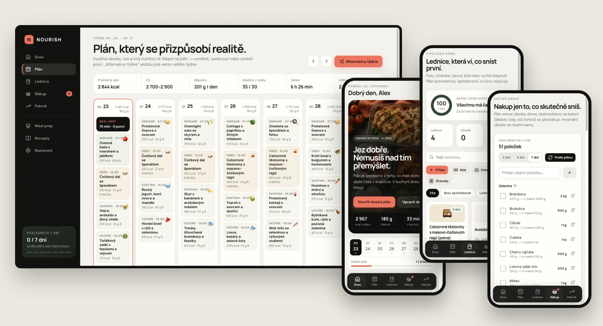

<div align="center">


# Nourish

**A private nutrition OS for one person: plan, fridge, shopping, meal prep.**
Eat well without thinking about it. The week is planned from what you already have at home, lunches come from Sunday meal prep, and the shopping list is "plan minus fridge".

an **EpicLifeDream** app · single owner · iPhone PWA + desktop planner · Czech UI · data stays in your own Vercel + Neon



**[Build your own Nourish →](docs/BUILD_YOUR_OWN.md)** — one prompt for Claude Code that forks this app, tailors it to you and deploys it.

</div>

> **A planner, not medical advice.** Targets are ranges, not prescriptions. Pregnancy,
> breastfeeding, an eating-disorder history, a medical condition, diabetes medication or
> age under 18 switch Nourish into "consult a professional" mode: maintenance only, no deficit.

## Features

| | |
|---|---|
| ☀️ **Today** | One tap per meal: eaten → stock is consumed (idempotent, first-expiring-first). Swap a meal, change the portion, or "rebuild the day" (less time, lighter dinner, eating out, more protein). Water, weigh-in, off-plan log by photo, barcode or quick entry. |
| 🗓️ **Week planner** | Deterministic, explainable planner: hard allergens and dislikes, uses what expires soon, protein per meal, fibre, 30 plants a week, weekday cooking time, budget, season. Lock meals, swap one, or compare **4 alternative weeks** (other recipes, quick, cheaper, more protein) before saving. |
| 🍱 **Meal prep** | Interleaved timeline (the oven runs while your hands do something else), cook mode with wake lock and parallel timers. "Done" consumes ingredients and stores portions with expiry dates. |
| 🧊 **Fridge** | Lots with expiry dates (FoodKeeper-style shelf life, shorter once opened). Add by barcode (Open Food Facts), by **photo of the fridge** (up to 6 photos at once, from camera or gallery) or of a receipt. Nothing is saved until you review it. Waste stats. |
| 🛒 **Shopping** | Plan minus stock, rounded to packs, staples skipped, minimum-stock rules. **Rohlík.cz cart fill** via the official MCP server: search, review, add to cart. Ordering and payment always stay with you. "Bought → move to fridge". |
| 📈 **Progress** | Smoothed weight trend, adaptive energy expenditure (TDEE) from your own data, weekly check-in, protein, plants, days on plan. No streak shaming. |
| 📲 **iPhone** | Installable PWA, offline shell, push reminders, Face ID passkeys, iOS Shortcuts (weight from Apple Health, "I ate it" via Siri, share a recipe link). |
| 🤖 **AI that costs nothing** | Fridge/receipt/meal photos and recipe import run on your own Cloudflare Worker with Workers AI (free tier). Switch to Claude via Vercel AI Gateway with one env var when you want better accuracy. |

## Privacy and security

Built for exactly one owner. Everything is behind your login: passkey (Face ID) or a long password (scrypt), lockout after repeated failures, a signed `__Host-` session cookie, and "sign out everywhere".
- Retailer OAuth tokens are encrypted with AES-256-GCM, and Shortcut tokens are stored only as hashes.
- The shop sees only your shopping list, never your health data.
- Of Rohlík's ~58 MCP tools, only product search, cart reading and cart adding are allowed. Checkout, payment, claims and cancellations are blocked.
- CSP, HSTS, `noindex` and an SSRF-guarded recipe import complete the setup.

Details: [`docs/DEPLOY.md`](docs/DEPLOY.md#security-model).

## Stack

Next.js 16 (App Router, `proxy.ts`) · React 19 · TypeScript strict · plain CSS tokens ·
Drizzle ORM · Neon Postgres on Vercel `fra1` (Docker Postgres locally) · Zod · Vitest ·
SimpleWebAuthn · Web Push (VAPID) · MCP SDK (OAuth 2.1 + PKCE) · AI SDK ·
Cloudflare Workers AI (`workers/vision`).

## Develop

```bash
npm install
npm run db:up                       # Postgres in Docker on :5434
npm run db:push && npm run db:seed  # schema + 88 ingredients, 31 Czech recipes
npm run dev                         # password without OWNER_PASSWORD_HASH: nourish-dev-heslo
npm test                            # planner, shopping diff, TDEE, allergens, prep, cart matching
```

## Documentation

| | |
|---|---|
| [`docs/BUILD_YOUR_OWN.md`](docs/BUILD_YOUR_OWN.md) | **Start here if you want your own copy**: the prompt for Claude Code |
| [`docs/DEPLOY.md`](docs/DEPLOY.md) | Vercel, Neon, Cloudflare worker, env vars, Rohlík, reminders, security model |
| [`docs/RESEARCH_AND_PLAN.md`](docs/RESEARCH_AND_PLAN.md) | Product research (MacroFactor, Mealime, Grocy, …) and roadmap |
| [`AGENT_HANDOFF.md`](AGENT_HANDOFF.md) | Original product brief |
| `src/lib/domain/` | Pure domain logic with tests: planner, shopping, nutrition, trend, prep |
| `src/lib/server/` | Database ops, auth, AI, push, retailer MCP |

## License

Personal project shared so others can build their own copy. Recipes and nutrition values
are approximate. Rohlík is a trademark of its owner, and Nourish only uses its public MCP server
with your own customer account.
